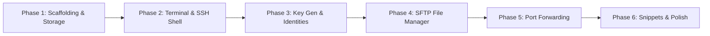

# Optimus: Android SSH & Terminal Client
## Architecture, Termius Inspection & Phased Implementation Roadmap

---

## 1. Executive Summary & Vision

**Optimus** is a modern, high-performance, open-source Android SSH, SFTP, and terminal client inspired by **Termius**. It is engineered to provide system administrators, DevOps engineers, and developers with a secure, reliable, and delightful mobile command-and-control experience.

### Core Pillars
- **Uncompromised Security:** Zero-knowledge client-side encryption, hardware-backed Android Keystore integration, biometric gatekeeping, and strict host verification.
- **Enterprise SSH Protocols:** Ed25519, ECDSA, RSA key generation, Jump Host (bastion / ProxyJump) chaining, and connection keep-alives.
- **Desktop-Grade Terminal:** Full ANSI / xterm-256color support, alternate screen buffer handling, custom mobile developer keyboard, and customizable fonts/themes.
- **Complete SFTP Management:** Multi-threaded dual-pane file browser, transfer queues, file permission management (`chmod`), and remote code editing.
- **Network Tunneling:** Local (`-L`), Remote (`-R`), and Dynamic SOCKS5 (`-D`) port forwarding.

---

## 2. Termius Architectural Inspection

Analysis of Termius Android (`com.server.auditor.ssh.client`):

```
┌──────────────────────────────────────────────────────────────────┐
│                             TERMIUS                              │
├─────────────────┬──────────────────┬──────────────┬──────────────┤
│  SSH-2 Core     │  Terminal Engine │ SFTP Browser │ Tunneling    │
│  - Ed25519/RSA  │  - VT100 / ANSI  │ - Dual Pane  │ - Local (-L) │
│  - Jump Host    │  - xterm-256     │ - Background │ - Remote (-R)│
│  - Port Fwd     │  - Extra Key Row │ - In-app Edit│ - SOCKS5 (-D)│
├─────────────────┴──────────────────┴──────────────┴──────────────┤
│                 Zero-Knowledge Personal Vault Layer              │
│        (Argon2id + Libsodium X25519 + XSalsa20-Poly1305)         │
├──────────────────────────────────────────────────────────────────┤
│           Platform Integration (Android NDK & Platform)          │
│   - libssh2 + OpenSSL (.so)    - Android Keystore (TEE/StrongBox)│
│   - Foreground Service         - BiometricPrompt API             │
└──────────────────────────────────────────────────────────────────┘
```

### Key Technical Findings
1. **Native SSH & Crypto Engines:**
   - **`libssh2` & `OpenSSL`:** Compiled as native C/C++ shared libraries (`.so`) for `arm64-v8a`, `armeabi-v7a`, `x86`, and `x86_64`. JNI bridges connect Android UI events to C socket event loops.
   - **`Libsodium`:** Used for client-side cryptographic primitives (X25519 key agreement, XSalsa20 symmetric ciphers, and Poly1305 MACs) for all vault data.
2. **Zero-Knowledge Security Architecture:**
   - All host records, credentials, private keys, and snippets are encrypted client-side using a master key derived from the user's passphrase (via memory-hard key derivation).
   - The remote cloud backend only stores and synchronizes encrypted ciphertext; plaintext credentials never traverse the wire or touch cloud disks.
3. **Android Lifecycle & Keep-Alive:**
   - Continuous SSH connections and active port forward tunnels require an Android **Foreground Service** with a persistent notification (`FOREGROUND_SERVICE_TYPE_DATA_SYNC` / `SPECIAL_USE`).
   - Acquisition of `WAKE_LOCK` and `WIFI_LOCK` prevents Android Doze mode and CPU throttling from tearing down active TCP connections.
4. **Local Database:**
   - Host configurations, identities, groups, and logs are stored inside an encrypted SQLite database using **SQLCipher**, with key material protected by the Android Keystore.

---

## 3. Technology Stack for Optimus

| Layer | Selected Technology | Rationale |
| :--- | :--- | :--- |
| **Language & Platform** | **Kotlin 2.0+** & Android SDK (minSdk 26, targetSdk 35) | Modern type-safe language with structured concurrency. |
| **UI Framework** | **Jetpack Compose + Material 3** | Declarative, reactive UI with fluid animations, dynamic theming, and tablet/foldable support. |
| **Concurrency & Async** | **Kotlin Coroutines & Flow** | Non-blocking asynchronous I/O and state management. |
| **SSH & SFTP Engine** | **`sshj` + BouncyCastle** *(or native `libssh2` via CMake)* | Pure Kotlin/Java compatibility, memory safety, active maintenance, full Ed25519/ECDSA/SFTP/tunneling support. |
| **Terminal Rendering** | Custom Compose Terminal with **ANSI/VT100 Buffer Engine** | Hardware-accelerated canvas rendering with full support for alternate screen buffers (`htop`, `vim`, `tmux`). |
| **Encrypted Database** | **Room + SQLCipher** | Type-safe ORM with 256-bit AES encryption at rest. |
| **Security & Keystore** | **Android Keystore (TEE/StrongBox) + BiometricPrompt** | Hardware-protected master keys and biometric gatekeeping. |
| **Dependency Injection** | **Hilt (Dagger)** | Scalable dependency graph and testability. |

---

## 4. Phased Implementation Roadmap



---

### Phase 1: Project Scaffolding, Core Architecture & Encrypted Storage
- [x] Initialize Android Gradle project in `D:\Optimus` with Gradle Version Catalog (`libs.versions.toml`).
- [x] Configure Android target SDK 35, minimum SDK 26, and Jetpack Compose toolchain.
- [x] Implement Clean Architecture layers:
  - `core-model`: Domain models (`Host`, `Identity`, `Group`, `KeyRecord`, `PortForwardRule`, `Snippet`).
  - `core-database`: Android Room with SQLCipher encryption.
  - `core-security`: Android Keystore manager and `BiometricPrompt` authentication helper.
  - `core-network`: SSH protocol abstraction interfaces.
- [x] Create UI navigation with Jetpack Compose Navigation:
  - Hosts Screen (list, group folders, status indicators).
  - Add / Edit Host Dialog.
  - App Settings & Master Security Lock Screen.

---

### Phase 2: Core SSH Engine, Terminal Emulator & Background Keep-Alive
- [x] Integrate SSH Protocol Client (`sshj` with BouncyCastle cryptographic provider).
- [x] Build the interactive Terminal Emulator:
  - ANSI / VT100 / xterm-256 color parser.
  - Virtual screen buffer supporting cursor movement, scrollback history, and alternate screen buffers (for `vim`, `nano`, `top`).
  - Font rendering with monospace support and glyph rendering.
- [x] Design the Mobile Developer Keyboard Toolbar:
  - Quick-access keys: `ESC`, `CTRL`, `ALT`, `TAB`, `Arrow Up/Down/Left/Right`, `PIPE |`, `~`, `/`, `-`.
  - Haptic feedback and visual active state toggles (e.g., sticky Ctrl/Alt).
- [x] Implement SSH Background Connection Service:
  - Android Foreground Service with ongoing notification.
  - `PowerManager.WakeLock` and `WifiManager.WifiLock` management.
  - Interactive live shell session streaming and verified real-world terminal usage.

---

### Phase 3: Key Management, Identities & Advanced Auth
- [x] Build in-app SSH Key Generator:
  - Algorithms: **Ed25519** (default), **ECDSA** (nistp256/384/521), **RSA** (2048/4096).
  - Passphrase protection for generated keys.
  - Automated OpenSSH wire-format serialization & SHA256 fingerprint generation.
- [x] Public/Private Key Import and Export:
  - Formats: OpenSSH (`id_ed25519`, `id_rsa`), PEM PKCS#8.
  - In-app key clipboard copy for `authorized_keys`.
- [x] Identities Management System:
  - Reusable identity profiles (Username + Password / Keypair).
  - Full CRUD UI with badges and credential association.
- [x] Bastion / Jump Host Chaining (`ProxyJump`):
  - In-memory `direct-tcpip` socket tunneling (`jumpClient.newDirectConnection` + `client.connectVia(tunnel)`).
  - Automatic multi-hop credential resolution (passwords, private keys, identities).
- [x] Modern Bottom Navigation:
  - Persistent Material 3 `NavigationBar` seamlessly transitioning between Hosts, Keys, and Identities.

---

### Phase 4: Dual-Pane SFTP File Browser & Remote Editor
- [ ] Implement SFTP Protocol Client Subsystem:
  - Remote directory tree traversal and fast metadata fetching (`stat`, `lstat`).
  - Permissions viewer and editor (`chmod` with numerical `755` and `rwx` toggles).
  - File actions: Rename, Delete, Make Directory, Create Symlink.
- [ ] Dual-Pane / Tabbed Browser UX:
  - View remote files alongside local Android storage (`MediaStore` / Document Provider).
  - Drag-and-drop or batch upload/download queues.
- [ ] Transfer Manager:
  - Background asynchronous file transfers with notification progress bars.
  - Resume interrupted transfers (file offset appending).
- [ ] In-App Remote File Editor:
  - Syntax-highlighted text editor for modifying remote configuration files.
  - Direct atomic save via temporary file swap over SFTP.

---

### Phase 5: Port Forwarding & Network Tunneling
- [ ] Local Port Forwarding (`-L local_port:remote_host:remote_port`):
  - Forward local Android loopback sockets to remote server network endpoints.
- [ ] Remote Port Forwarding (`-R remote_port:local_host:local_port`):
  - Expose local Android or LAN endpoints on the remote server interface.
- [ ] Dynamic Port Forwarding (`-D socks_port`):
  - In-app local SOCKS5 proxy server routing network traffic transparently over encrypted SSH tunnels.
- [ ] Tunnel Dashboard & Diagnostics:
  - Real-time connection status toggles.
  - Live upload/download bandwidth and byte count counters.

---

### Phase 6: Snippets, Customization, Cloud Sync & Polish
- [ ] Snippets Engine:
  - Pre-saved multi-line scripts categorized by tags and server groups.
  - Dynamic parameter interpolation (e.g. `docker logs -f {{container_id}}`).
  - One-tap snippet injection into active terminal sessions.
- [ ] Terminal Themes & Appearance:
  - Color palettes: Dracula, Solarized Dark, Monokai, Nord, Gruvbox, One Dark.
  - Monospace developer fonts: JetBrains Mono, Fira Code (with ligatures), Source Code Pro.
- [ ] Zero-Knowledge Vault Export & Backup:
  - Encrypted backup file export (`.optimus` encrypted JSON vault).
  - Optional self-hosted WebDAV / custom API sync server with client-side end-to-end encryption.

---

## 5. Security & Verification Standards

1. **Memory Hygiene:**
   - Plaintext passwords and decrypted private key byte arrays must be stored in `CharArray` / `ByteArray` and explicitly zeroed out (`Arrays.fill(bytes, 0)`) immediately after authentication.
2. **Strict Host Checking:**
   - Unknown host keys must trigger explicit user confirmation before connection handshake completion.
3. **Android Sandbox Protection:**
   - All sensitive data stored exclusively in `context.getNoBackupFilesDir()` or encrypted with SQLCipher so that standard Android cloud backups do not leak credentials.
